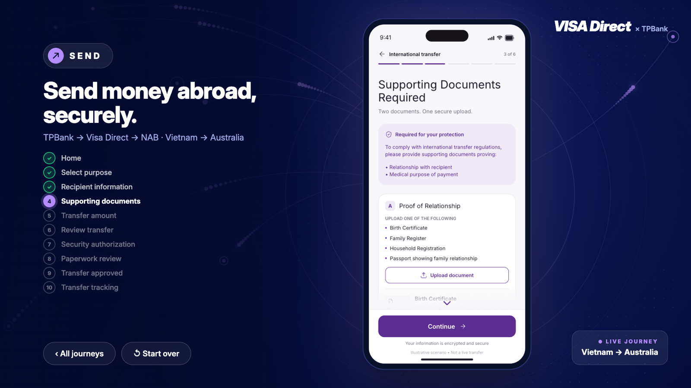
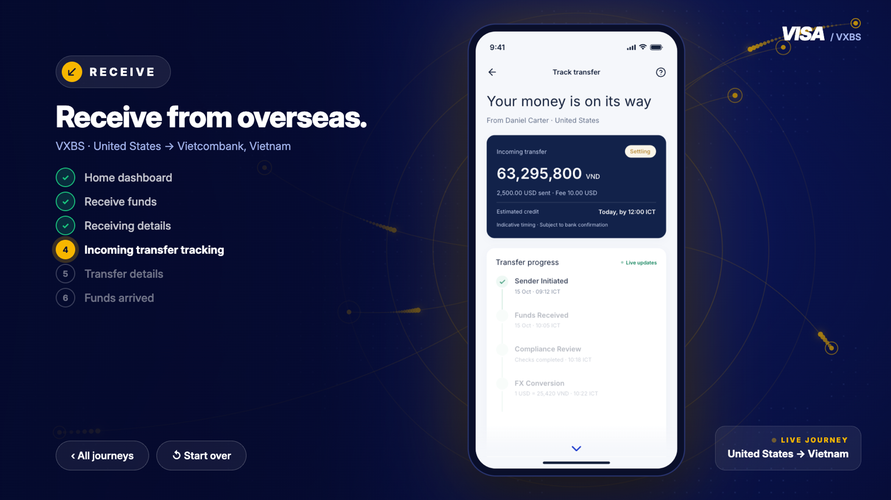
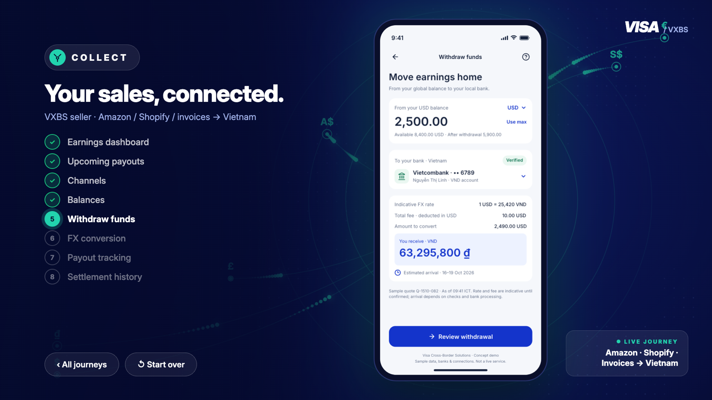

# Visa Direct Booth: Interactive Kiosk Demo

An interactive experience for the **Visa Direct** booth at the forum. Visitors walk through three money-movement journeys (**SEND · RECEIVE · COLLECT**) on a 16:9 touch screen. Each journey plays the real app screens from the Figma prototypes inside a phone on the kiosk.

## Demo

| | Link |
|---|---|
| **Vercel** | https://vd-booth-demo.vercel.app |
| GitHub Pages (mirror) | https://noattoan.github.io/vd-booth-demo/ |
| Verification report | https://vd-booth-demo.vercel.app/docs/verify/report.html |
| Screen-by-screen workflow | https://vd-booth-demo.vercel.app/docs/workflow.html |

One link per booth screen (each locks the screen to a single journey):

- SEND: https://vd-booth-demo.vercel.app/?zone=send
- RECEIVE: https://vd-booth-demo.vercel.app/?zone=receive
- COLLECT: https://vd-booth-demo.vercel.app/?zone=collect


| Choose a journey | Journey | Done + QR |
|---|---|---|
|  |  |  |

| RECEIVE | COLLECT |
|---|---|
|  |  |

## Journeys

All 24 screens come from two Figma prototypes and keep their copy, figures and layout exactly (see `figma/`).

| Journey | Story | Steps |
|---|---|---|
| **SEND**: VISA Direct × TPBank | A TPBank customer in Vietnam sends AUD 2,900 to a family member's NAB account in Australia for medical expenses: purpose → recipient → supporting documents (OCR checked) → amount with FX rate lock → review → Face ID → paperwork review → approved → 6-stage tracking. | 10 |
| **RECEIVE**: VISA / VXBS | Linh in Vietnam receives 2,500 USD from Daniel Carter in the US: quote → USD receiving details and QR → live tracking → transfer details → funds arrived in Vietcombank (63,295,800 VND). | 6 |
| **COLLECT**: VISA / VXBS seller | Linh Studio collects marketplace earnings: earnings dashboard → upcoming payouts → connected channels (Amazon, Shopify, invoices) → multi-currency balances → withdraw → FX conversion → payout tracking → settlement history. | 8 |

How visitors move through each journey (one hotspot per screen, kiosk **Next** and **Finish** where the design has no call to action, auto-advance on status screens) is documented in [`docs/workflow.html`](docs/workflow.html). The product decisions are in [`docs/DECISIONS.md`](docs/DECISIONS.md).

## Features

- **Attract screen** with a global money-flow animation. Touch anywhere to start.
- **Phone screens generated from Figma.** Long screens scroll inside the phone and show an animated scroll hint at the bottom. Header and footer stay fixed, as in the design.
- **Motion** on key moments: Face ID scan, timelines ticking stage by stage, count-ups, confetti when funds arrive.
- **Done screen** with a product summary and a QR code (default: https://vd-booth-demo.vercel.app/).
- **English only**, with the brand shown per journey.
- **16:9 landscape** (designed at 1920×1080, scales to any screen). On a portrait display the stage rotates to stay landscape.
- **Built to run all day:**
  - returns to the attract screen when idle;
  - reloads periodically while on the attract screen;
  - keeps the display awake;
  - runs **fully offline**, with the Inter font and the QR library in `vendor/`.

## URL parameters

| Parameter | Meaning | Default |
|---|---|---|
| `zone=send\|receive\|collect` | Lock the screen to one journey | journey picker |
| `idle=60` | Seconds without a touch before returning to the attract screen | `60` |
| `reload=2` | Hours between automatic reloads (attract screen only, `0` = off) | `2` |
| `fx=low` | Lighter background animation for low-end machines | full |
| `qr=https://...` | URL encoded in the Done screen QR code | `https://vd-booth-demo.vercel.app/` |
| `goto=home \| send:3 \| done:collect` | Jump straight to a screen (1-based step, for testing) | none |
| `solo=send-1` | Render a single phone screen at 1x and full Figma height, without the kiosk (used by the verification harness). Format `zone-n`, n is 1-based | none |
| `solo=receive-2&clip=1` | The same screen inside the 402×874 kiosk viewport (fixed header and footer) | none |

Keyboard shortcuts: `F` full screen · `Esc` back to the attract screen · `1/2/3` open SEND / RECEIVE / COLLECT.

## Running at the booth

It is a static site with no build step. Either:

1. **Online:** open one of the links above.
2. **Offline (recommended for the event):** copy the whole folder onto the machine and open `index.html`.

Chrome in kiosk mode (Windows, put it in Startup):

```
chrome.exe --kiosk "https://vd-booth-demo.vercel.app/?zone=send" --noerrdialogs --disable-session-crashed-bubble --disable-pinch --overscroll-history-navigation=0
```

Checklist for each machine:

- **Windows:**
  - set Power & sleep to **Never**;
  - turn off the screensaver;
  - pause Windows Update for the event.
- **BIOS:** enable **Power On after AC loss**, so the machine restarts by itself after a power cut.
- **Display:** use a commercial display rated for **24/7**, with Eco, auto power-off and no-signal standby turned off.
- **Backup:** one UPS per screen, plus a spare machine set up identically.

## Updating the screens from Figma

The phone screens are generated, never edited by hand:

```bash
export FIGMA_API_KEY=figd_…                                    # Figma personal access token
node scripts/framelink.mjs get_figma_data '{"fileKey":"…"}'    # Framelink pull (see figma/README.md)
node scripts/gen/build-screens.mjs                             # figma/rest/*.json → screens/gen/*
pnpm install --dir scripts/verify && pnpm --dir scripts/verify verify
```

The verification harness compares every screen with Figma on five layers:

1. text (verbatim, Inter only);
2. geometry (every node within 2px);
3. typography and box style;
4. pixels (≤ 3% against the Figma renders);
5. the end-to-end kiosk flow, offline.

It writes `docs/verify/report.html`. The method and thresholds are in [`docs/IMPL-PLAN.md`](docs/IMPL-PLAN.md).

## Structure

```
index.html                    # kiosk shell + styles
app.js                        # navigation, solo mode, idle, background animation, window.VD
screens/gen/screens.{js,css}  # GENERATED from figma/rest/*.json, do not edit by hand
screens/phone.css             # phone host, kiosk/solo modes, scroll hint, motion
screens/behaviors.js          # hotspots, back, auto-advance, per-screen motion
scripts/gen/                  # generator: node scripts/gen/build-screens.mjs
scripts/verify/               # verification harness: pnpm --dir scripts/verify verify
scripts/framelink.mjs         # Framelink (figma-developer-mcp) client used to pull the designs
figma/                        # Figma source of truth: REST + Framelink JSON, frame renders, SVG assets
vendor/                       # Inter 4.1 (InterVariable) + qrcode.js, for offline use
docs/                         # workflow, decisions, implementation plan, verify report, screenshots
```

## Notes

- **Placeholders.** Logos, wordmarks, product descriptions and scenario data (rates, names, account numbers) are demo placeholders. Replace them with Visa-approved brand assets and content before any official use.
- **Figma copy and figures are kept as designed.** Some known design inconsistencies are listed under "Notes for the designer" in `docs/DECISIONS.md`.
