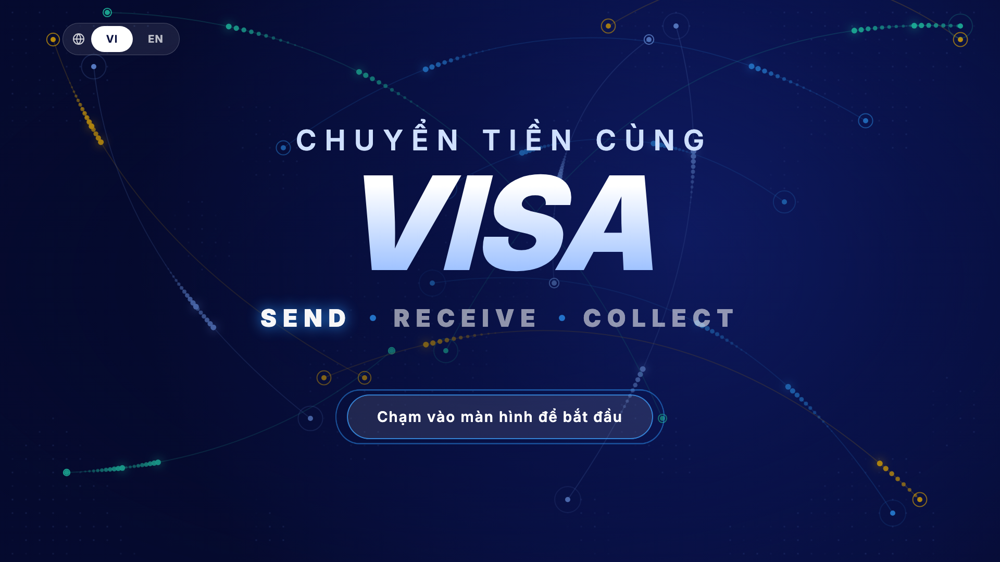
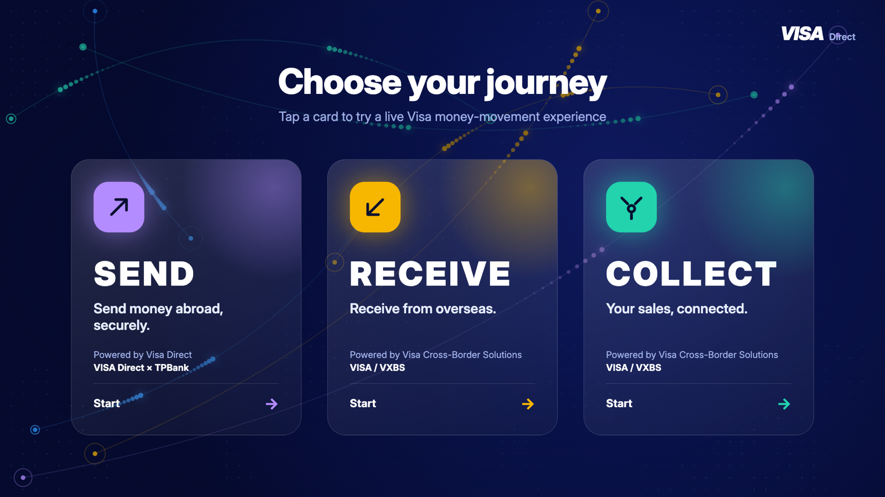
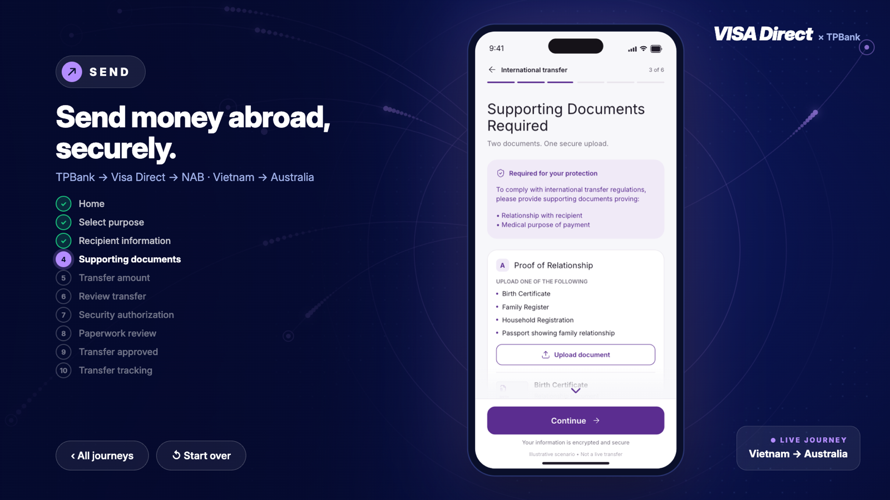
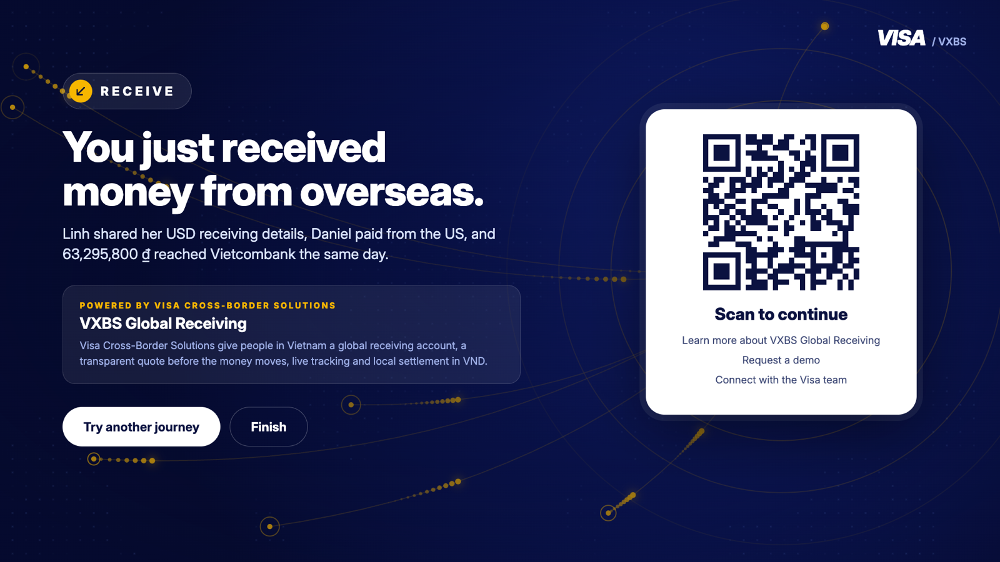
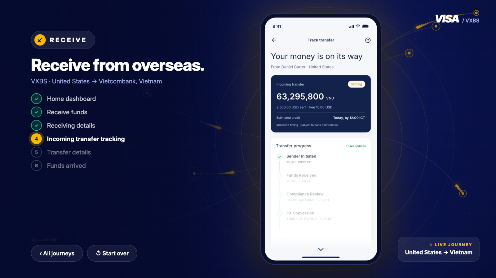
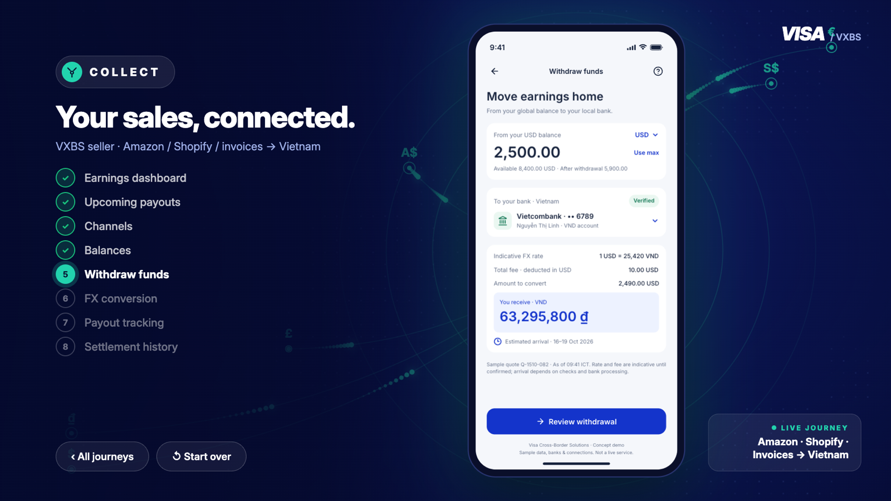

# Visa Direct Booth: Interactive Kiosk Demo

An interactive experience for the **Visa Direct** booth at the forum. Visitors walk through three money-movement journeys (**SEND · RECEIVE · COLLECT**) on a 16:9 touch screen. Each journey plays the real app screens from the Figma prototypes inside a phone on the kiosk.

## Demo

| | Link |
|---|---|
| **Vercel** | https://vd-booth-demo.vercel.app |
| GitHub Pages (mirror) | https://noattoan.github.io/vd-booth-demo/ |
| Verification report | https://vd-booth-demo.vercel.app/docs/verify/report.html |
| Screen-by-screen workflow | https://vd-booth-demo.vercel.app/docs/workflow.html |

One link per booth screen (each locks the screen to a single experience):

- SEND · Send at Vietnam Pioneer Bank via Visa Direct: https://vd-booth-demo.vercel.app/?zone=send
- RECEIVE · Individual receiver via VXBS: https://vd-booth-demo.vercel.app/?zone=vxbs-individual
- RECEIVE · E-seller withdrawal via VXBS: https://vd-booth-demo.vercel.app/?zone=vxbs-seller
- RECEIVE · Cross-border AFT, friends and family (me-to-you): https://vd-booth-demo.vercel.app/?zone=aft-family
- RECEIVE · Cross-border AFT, travel app (me-to-me): https://vd-booth-demo.vercel.app/?zone=aft-travel



| Choose a journey | Journey | Done + QR |
|---|---|---|
|  |  |  |

| RECEIVE | COLLECT |
|---|---|
|  |  |

## Journeys

All 61 screens come from four Figma prototypes and keep their copy, figures and layout exactly; `figma/` is the single source of truth.

| Experience | Story | Steps |
|---|---|---|
| **SEND**: VISA Direct × Vietnam Pioneer Bank | A Vietnam Pioneer Bank customer in Vietnam sends AUD 2,900 to a family member's NAB account in Australia for medical expenses: purpose → recipient → supporting documents (OCR checked) → amount with FX rate lock → review → Face ID → paperwork review → approved → 6-stage tracking → Visa Direct confirmation. | 11 |
| **RECEIVE · Individual receiver** via VXBS | Linh in Vietnam receives 2,500 USD from Daniel Carter in the US: quote → USD receiving details and QR → live tracking → transfer details → funds arrived in Vietnam Bank (63,295,800 VND). | 6 |
| **RECEIVE · E-seller withdrawal** via VXBS | Linh Studio collects marketplace earnings: earnings dashboard → upcoming payouts → connected channels (Amazon, Shopify, invoices) → multi-currency balances → withdraw → FX conversion → payout tracking → settlement history. | 8 |
| **RECEIVE · Friends & family**: cross-border AFT, me-to-you (NovaBank) | Minh Anh in Vietnam requests USD 200 from Sarah in the US with a secure link: request → share via iMessage → *Sarah's phone:* secure payment page → pay with Visa (USD 202 incl. fee) → Visa Secure → sent → *Minh Anh's phone:* notification → 4,900,000 VND in her bank account in 2m 28s. The kiosk shows whose phone is on screen. | 18 |
| **RECEIVE · Travel wallet**: cross-border AFT, me-to-me (XinChaoVietnam) | James from Australia creates a Vietnam travel wallet, links his Visa Debit, adds AUD 500 = 8,500,000 ₫, then pays Lotus Coffee in Hanoi by QR (185,000 ₫) and reviews his wallet and trip. | 18 |

How visitors move through each journey (one hotspot per screen, kiosk **Next** and **Finish** where the design has no call to action, auto-advance on status screens) is documented in [`docs/workflow.html`](docs/workflow.html). The product decisions are in [`docs/DECISIONS.md`](docs/DECISIONS.md).

## End-to-end tests (Playwright)

```bash
pnpm --dir tests/e2e install
pnpm --dir tests/e2e test          # 61 screens vs Figma, 5 journeys clicked to Done, inert-button check
open tests/e2e/compare/index.html  # before / after: Figma | build | diff per screen, slider, kiosk shots
```

Uses the installed Google Chrome (`channel: 'chrome'`). A screen passes when it has the Figma frame size and at most
3 % of pixels differ (anti-aliasing ignored), the same gate as the verify harness's P1.

## Features

- **Attract screen** with a global money-flow animation. Touch anywhere to start.
- **Phone screens generated from Figma.** Long screens scroll inside the phone; header and footer stay fixed, as in the design. A **Scroll for more** cue sits outside the phone (bottom right, above Next) while there is more below, scrolls the phone when tapped, and hides at the bottom.
- **Where to tap:** every step's call to action carries a steady glow and a pulsing wave (from ~1.2 s, or once auto-populate finishes); Next / Finish pulse on the steps without one.
- **Motion** on key moments: Face ID scan, timelines ticking stage by stage, count-ups, confetti when funds arrive.
- **Auto-populate**: on the form screens (SEND 3, travel 2 / 5 / 7, F&F 3) each field types itself in to its Figma value, then the call to action pops for the visitor to tap. F&F 11 (an empty card form in Figma) simulates the card: Sarah Nguyen, 4111 1234 5678 4812, 08/29.
- **Favicon:** `brand/favicon.svg` (+ 32 px PNG and an Apple touch icon), the Visa wordmark on Visa blue, on the kiosk and the lead form.
- **Visa branding (Payments in Motion · Money Movement Edition, client pack 2026-11-11):** the attract screen is the Make's splash: the KV background image `brand/kv-background.jpg` (Make image-35.png) zooming in, thin gold/white streaks sweeping across, the Visa wordmark `brand/visa-wordmark.svg`, the title lockup `brand/kv-title.png`, an accent sweep, "Ho Chi Minh, Vietnam"); every kiosk-shell text and the lead form use **Visa Dialect** (`vendor/fonts/VisaDialect-Regular.ttf`, regular only, no faux bold). The phone screens keep the Figma fonts. `brand/kv-reference.jpg` is the client's KV for comparison. The vector marks (`visa-wordmark.svg`, `visa-direct-lockup.svg`, `visa-wordmark-blue.svg` for "Enabled by VISA") and the accent sweep come from the client's Figma Make "Payments in Motion: Money Movement Edition", read through the Figma MCP.
- **Kiosk Next / Finish** beside the phone (bottom right, outside the device) on the steps whose design has no call to action. Only elements wired to an action give touch feedback; look-alike buttons that do nothing in the demo stay still.
- **Done screen** with a product summary and a QR code to the **lead form** (`/lead/?exp=<experience>`; override with `?qr=`).
- **Lead capture**: https://vd-booth-demo.vercel.app/lead/ (phone page in the Visa Direct look of the Figma files) posts to `/api/lead`, a Vercel Function that stores the lead in the Neon Postgres database `vd-booth-leads` (Vercel Marketplace, env `DATABASE_URL`). Consent is required and its wording is stored with each lead. Export for the booth team:
  `curl -H "Authorization: Bearer $(cat ~/.vd-booth-leads-token)" https://vd-booth-demo.vercel.app/api/leads > leads.csv` (token = Vercel env `LEADS_ADMIN_TOKEN`).
  `?format=json` gives JSON. Validation (`api/_validate.js`, mirrored in the page): name of letters (2–120), a real email shape, phone 7–15 digits (stored as `+84912345678`), length limits, consent v1 required and stored by the server's own wording; spam (honeypot, sent in < 2.5 s) is dropped; the same email within 10 min is not stored twice; at most 20 leads / 10 min per network (keyed IP hash only).
  Live check: `LIVE=1 pnpm --dir tests/e2e test lead` submits on production, reads the rows back through the export API, saves `tests/e2e/compare/lead/export.{csv,json}`, then deletes its own `e2e-test:*` rows.
- **English only**, with the brand shown per journey.
- **16:9 landscape** (designed at 1920×1080, scales to any screen). On a portrait display the stage rotates to stay landscape.
- **Built to run all day:**
  - returns to the attract screen when idle;
  - reloads periodically while on the attract screen;
  - keeps the display awake;
  - runs **fully offline**, with the fonts (Inter, Lora, Arimo) and the QR library in `vendor/`.

## URL parameters

| Parameter | Meaning | Default |
|---|---|---|
| `zone=send\|vxbs-individual\|vxbs-seller\|aft-family\|aft-travel` | Lock the screen to one experience (short keys `receive`, `collect`, `family`, `travel` also work) | experience picker |
| `idle=60` | Seconds without a touch before returning to the attract screen | `60` |
| `reload=2` | Hours between automatic reloads (attract screen only, `0` = off) | `2` |
| `fx=low` | Lighter background animation for low-end machines | full |
| `qr=https://...` | URL encoded in the Done screen QR code | `https://vd-booth-demo.vercel.app/` |
| `goto=home \| send:3 \| done:collect` | Jump straight to a screen (1-based step, for testing) | none |
| `solo=send-1` | Render a single phone screen at 1x and full Figma height, without the kiosk (used by the verification harness). Format `zone-n`, n is 1-based | none |
| `solo=receive-2&clip=1` | The same screen inside the 402×874 kiosk viewport (fixed header and footer) | none |

Keyboard shortcuts: `F` full screen · `Esc` back to the attract screen · `1/2/3` open SEND / RECEIVE / COLLECT.

## Running at the booth

It is a static site with no build step. Either:

1. **Online:** open one of the links above.
2. **Offline (recommended for the event):** copy the whole folder onto the machine and open `index.html`.

Chrome in kiosk mode (Windows, put it in Startup):

```
chrome.exe --kiosk "https://vd-booth-demo.vercel.app/?zone=send" --noerrdialogs --disable-session-crashed-bubble --disable-pinch --overscroll-history-navigation=0
```

Checklist for each machine:

- **Windows:**
  - set Power & sleep to **Never**;
  - turn off the screensaver;
  - pause Windows Update for the event.
- **BIOS:** enable **Power On after AC loss**, so the machine restarts by itself after a power cut.
- **Display:** use a commercial display rated for **24/7**, with Eco, auto power-off and no-signal standby turned off.
- **Backup:** one UPS per screen, plus a spare machine set up identically.

## Updating the screens from Figma

The phone screens are generated, never edited by hand:

```bash
export FIGMA_API_KEY=figd_…                                    # Figma personal access token
node scripts/framelink.mjs get_figma_data '{"fileKey":"…"}'    # Framelink pull (see figma/README.md)
node scripts/gen/build-screens.mjs                             # figma/rest/*.json → screens/gen/*
pnpm install --dir scripts/verify && pnpm --dir scripts/verify verify
```

The verification harness compares every screen with Figma on five layers:

1. text (verbatim, Inter only);
2. geometry (every node within 2px);
3. typography and box style;
4. pixels (≤ 3% against the Figma renders);
5. the end-to-end kiosk flow, offline.

It writes `docs/verify/report.html`. The method and thresholds are in [`docs/IMPL-PLAN.md`](docs/IMPL-PLAN.md).

## Structure

```
index.html                    # kiosk shell + styles
app.js                        # navigation, solo mode, idle, background animation, window.VD
screens/gen/screens.{js,css}  # GENERATED from figma/rest/*.json, do not edit by hand
screens/phone.css             # phone host, kiosk/solo modes, scroll hint, motion
screens/behaviors.js          # hotspots, back, auto-advance, per-screen motion
scripts/gen/                  # generator: node scripts/gen/build-screens.mjs
scripts/verify/               # verification harness: pnpm --dir scripts/verify verify
scripts/framelink.mjs         # Framelink (figma-developer-mcp) client used to pull the designs
figma/                        # Figma source of truth: REST + Framelink JSON, frame renders, SVG assets
vendor/                       # Inter 4.1 (InterVariable) + qrcode.js, for offline use
docs/                         # workflow, decisions, implementation plan, verify report, screenshots
```

## Notes

- **Brand and data.** Logos, wordmarks, the KV and Visa Dialect come from the Visa brand pack and Figma Make (web use approved 2026-11-11). Scenario data in the phone screens (rates, names, account numbers) are the designs' illustrative demo values.
- **Figma copy and figures are kept as designed.** Some known design inconsistencies are listed under "Notes for the designer" in `docs/DECISIONS.md`.
