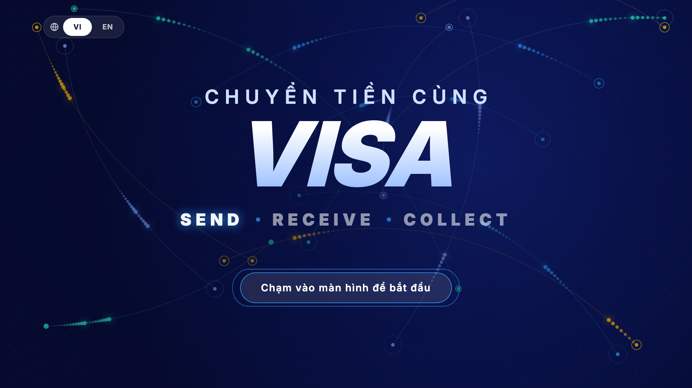
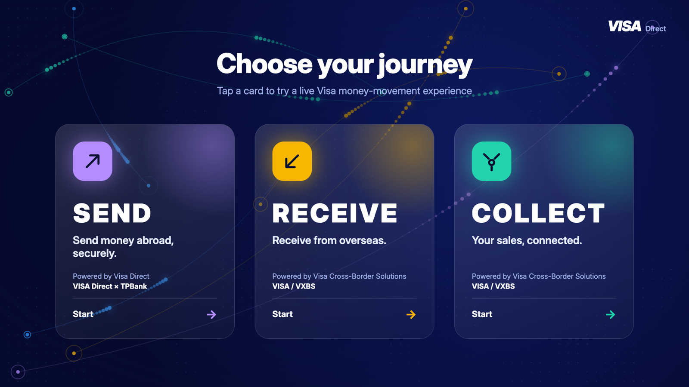
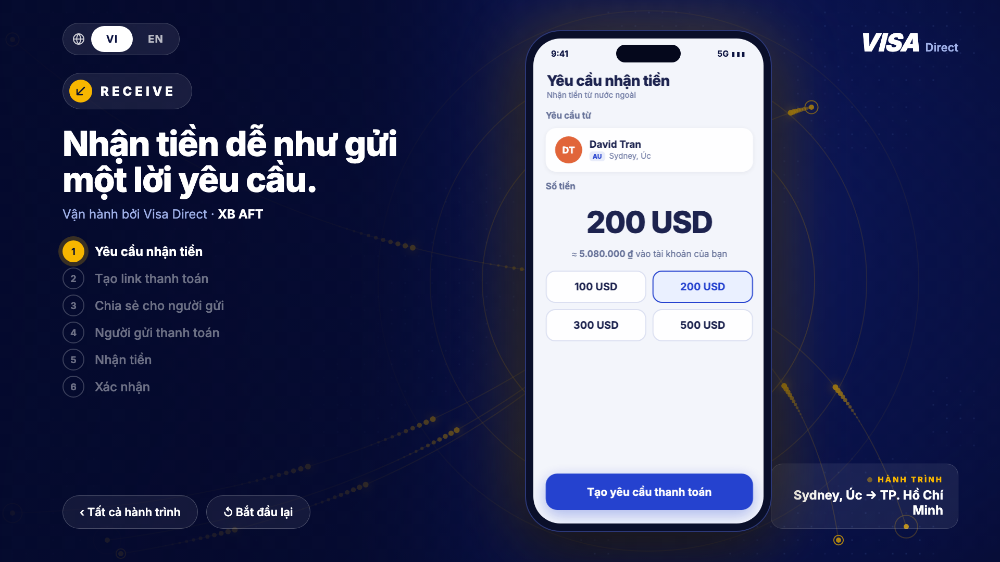
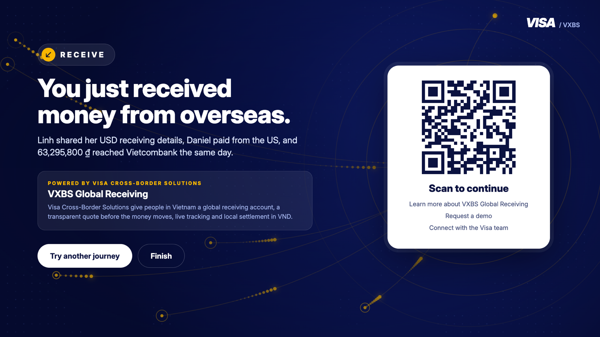

# Visa Direct Booth — Interactive Kiosk Demo

Trải nghiệm tương tác cho booth **Visa Direct** tại forum: 3 hành trình chuyển tiền **SEND · RECEIVE · COLLECT** chạy trên màn hình/TV cảm ứng 16:9 trong booth.

## 🔗 Demo

| | Link |
|---|---|
| **GitHub Pages** | https://noattoan.github.io/vd-booth-demo/ |
| Vercel (mirror) | https://vd-booth-demo.vercel.app |

Link cho từng TV trong booth (mỗi màn khoá vào một hành trình):

- SEND — https://noattoan.github.io/vd-booth-demo/?zone=send
- RECEIVE — https://noattoan.github.io/vd-booth-demo/?zone=receive
- COLLECT — https://noattoan.github.io/vd-booth-demo/?zone=collect



| Chọn hành trình | Trải nghiệm | Kết thúc + QR |
|---|---|---|
|  |  |  |

## Tính năng

- **3 hành trình** theo creative brief:
  - **SEND** (Visa Direct Account & Wallet — VDAW): chọn người nhận → nhập số tiền → chọn nơi nhận → xem lại → gửi → xác nhận
  - **RECEIVE** (Cross-Border AFT — XB AFT): yêu cầu nhận tiền → tạo link → chia sẻ → người gửi thanh toán → nhận tiền → xác nhận
  - **COLLECT** (Visa Cross-Border Solutions — VXBS): tài khoản nhận → chia sẻ → nhận tiền → xem số dư → quy đổi → rút/quản lý
- **Màn chờ (attract)** với animation dòng tiền toàn cầu; chạm để bắt đầu.
- **Màn kết thúc** giải thích sản phẩm Visa + **QR code** (tìm hiểu thêm / đặt lịch demo / kết nối đội Visa).
- **Chỉ tiếng Anh** (kể cả khung kiosk). Màn điện thoại dựng từ 2 prototype Figma (SEND 10, RECEIVE 6, COLLECT 8 bước).
- **16:9 ngang** (thiết kế 1920×1080, tự scale cho mọi màn); điện thoại cầm dọc tự xoay nội dung ngang.
- **Chạy ổn định cả ngày**: tự về màn chờ khi không ai chạm, tự reload định kỳ ở màn chờ, giữ màn hình luôn sáng, chạy **offline hoàn toàn** (font + thư viện QR nằm trong `vendor/`).

## Tham số URL

| Tham số | Ý nghĩa | Mặc định |
|---|---|---|
| `zone=send\|receive\|collect` | Khoá màn hình vào một hành trình | màn chọn hành trình |
| `idle=60` | Số giây không chạm trước khi về màn chờ | `60` |
| `reload=2` | Số giờ giữa các lần tự reload (chỉ ở màn chờ, `0` = tắt) | `2` |
| `fx=low` | Animation nhẹ cho máy yếu | đầy đủ |
| `qr=https://...` | Link trong QR code màn kết thúc | `https://vd-booth-demo.vercel.app/` |
| `goto=home \| send:3 \| done:collect` | Nhảy thẳng tới một màn (bước đếm từ 1, để test) | — |
| `solo=send-1` | Chỉ render một màn điện thoại, không scale, đủ chiều cao Figma (để kiểm tra); `zone-n`, n đếm từ 1 | — |
| `solo=receive-2&clip=1` | Màn đó trong khung 402×874 của kiosk (header/footer cố định) | — |

Phím tắt: `F` toàn màn hình · `Esc` về màn chờ · `1/2/3` mở SEND/RECEIVE/COLLECT.

## Chạy tại booth

Trang tĩnh, không cần build. Có 2 cách:

1. **Online:** mở link GitHub Pages/Vercel ở trên.
2. **Offline (khuyến nghị cho sự kiện):** copy cả thư mục vào máy, mở `index.html`.

Chrome chế độ kiosk (Windows, đặt trong Startup):

```
chrome.exe --kiosk "https://noattoan.github.io/vd-booth-demo/?zone=send" --noerrdialogs --disable-session-crashed-bubble --disable-pinch --overscroll-history-navigation=0
```

Checklist máy chạy:

- Windows **Power & sleep → Never**, tắt screensaver, tạm dừng Windows Update trong thời gian sự kiện.
- BIOS: **Power On after AC loss** để tự bật lại sau khi mất điện.
- Màn hình thương mại chạy **24/7**, tắt Eco / auto power-off / no-signal standby.
- Mỗi màn có UPS; chuẩn bị máy dự phòng cài sẵn giống hệt.

## Cấu trúc

```
index.html                    # khung kiosk + style
app.js                        # điều hướng, solo mode, idle, animation nền, window.VD
screens/gen/screens.{js,css}  # SINH TỰ ĐỘNG từ figma/rest/*.json — không sửa tay
screens/phone.css             # khung điện thoại, kiosk/solo, scroll hint, hiệu ứng
screens/behaviors.js          # hotspot, back, chuyển động từng màn
scripts/gen/                  # generator: node scripts/gen/build-screens.mjs
vendor/                       # Inter 4.1 (InterVariable) + qrcode.js — để chạy offline
docs/             # ảnh chụp màn hình cho README
```

## Lưu ý

Logo/wordmark, nội dung mô tả sản phẩm và số liệu (tỷ giá, tên người, số tài khoản) là **placeholder** cho bản demo — cần thay bằng tài sản thương hiệu và nội dung được Visa phê duyệt trước khi dùng chính thức. Màn điện thoại được sinh từ prototype Figma (`figma/`); khi Figma đổi thì pull lại rồi chạy `node scripts/gen/build-screens.mjs`.
